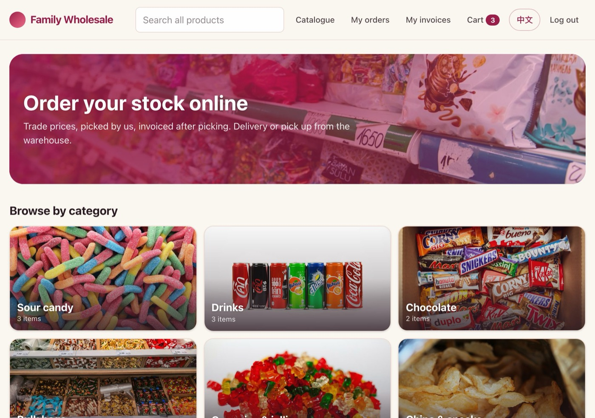
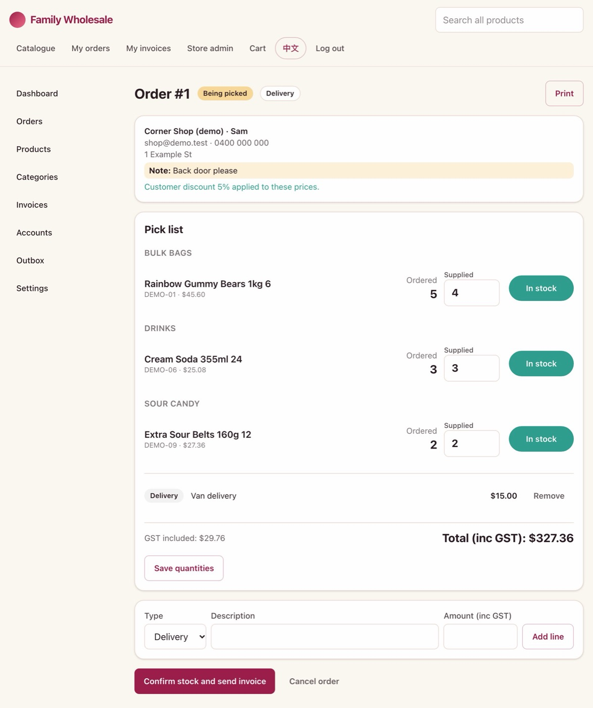
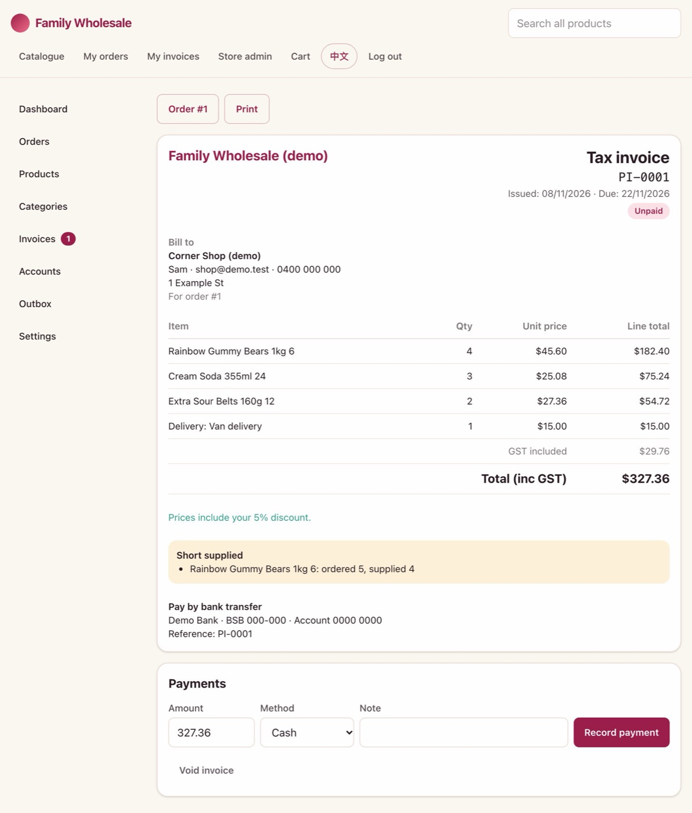
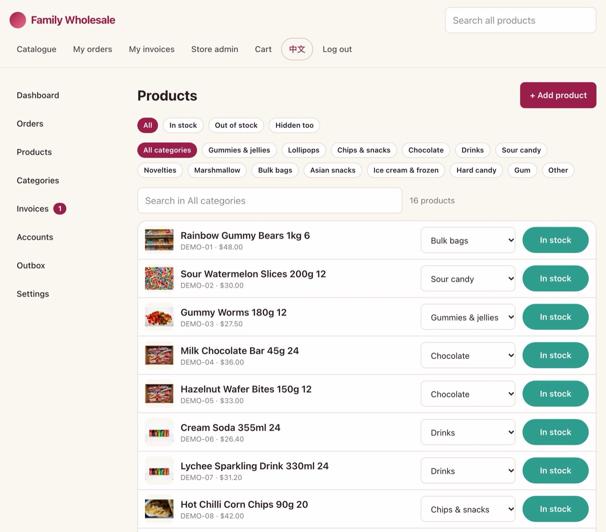
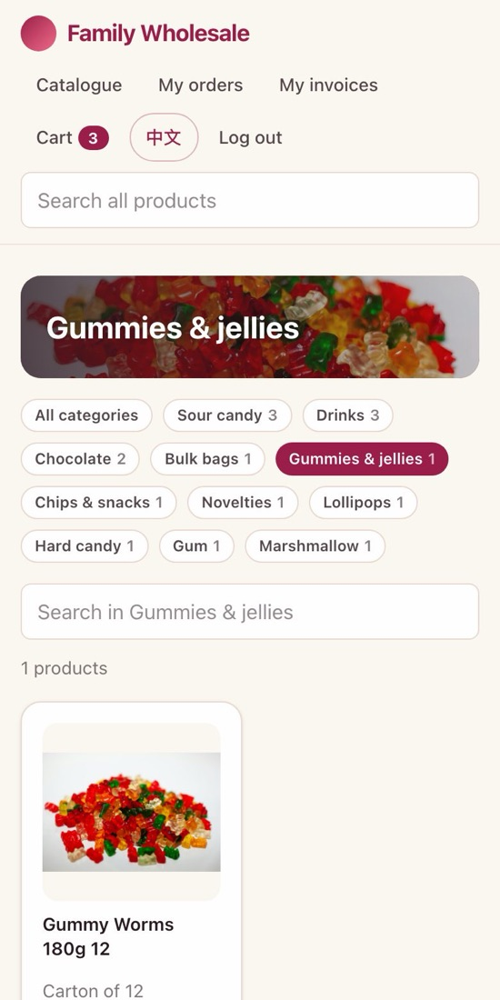
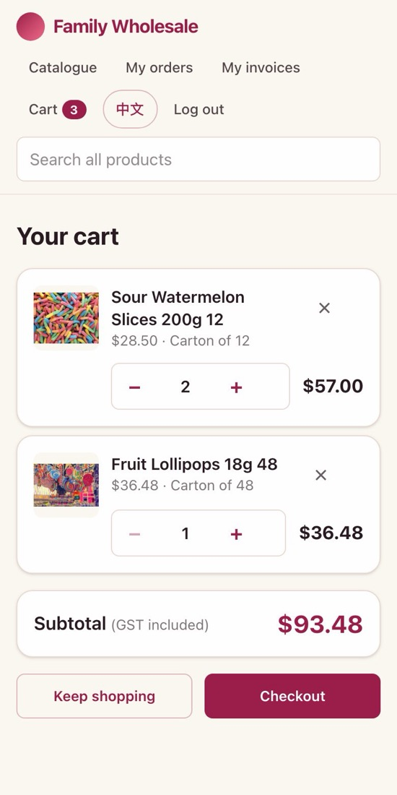
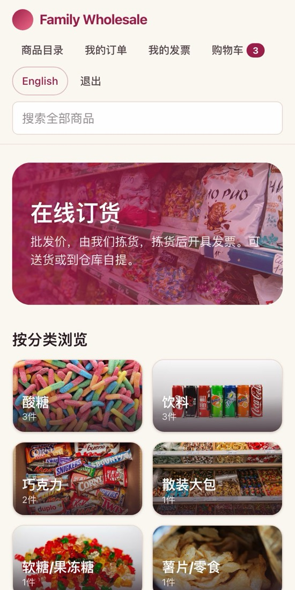

<a href="#zh">中文版请往下看 →</a>

Mum, Dad,

You know the ordering website the shops use now. I didn't write it myself. I told an AI (artificial intelligence) called Claude what we needed, in plain words, the way I'd explain it to you. Claude built it, asked me questions when it wasn't sure, and fixed whatever I said looked wrong.

This page shows how I did it, starting from switching on the computer, so you can try it too. You can even type to it in Chinese.

<figure class="g-fig">
  
  <figcaption>The ordering website. The pictures on this page come from a practice copy with made-up products and prices, so they won't match ours exactly.</figcaption>
</figure>

## What is Claude?

Claude is a program you type to, like sending a WeChat message to a very patient helper. It writes back in seconds. It can answer questions, and the part I used can also *make things* on your computer, like a website.

It knows nothing about the shop until you tell it. So it goes round like this:

  
<strong>You say what you want</strong>, in your own words. Typos are fine.

  
<strong>It asks you questions</strong> until it understands.

  
<strong>It makes it</strong>, and checks its own work.

  
<strong>You try it</strong> and tell it what's wrong.

Steps 3 and 4 repeat until you're happy.

## What you need

- **A computer:** a Mac or a Windows PC. An iPad won't work for these steps.
- **Internet.**
- **A paid Claude plan.** The part that makes things is called *Claude Code*, and the free plan doesn't include it. The cheapest plan that does is **Pro**, about US$20 a month in November 2026. You pay by card. The price in your currency is on the [pricing page](https://claude.com/pricing).
- **Something to work from.** For the ordering website, I used the sales report from your invoicing app: the spreadsheet with every product, its code and its price.
- **Some patience.** My first version took one evening. Then I kept asking for changes over the next few days.

## Part 1: Setting up (you only do this once)

Mac or Windows? A Mac has an Apple logo in the top-left corner of the screen. Windows has a logo of four squares at the bottom.

1. **Switch on the computer and log in** as usual.
2. **Open the web browser.** That's the program you use for websites, such as Safari, Chrome or Edge. Click the long box at the very top, type **claude.ai**, and press Enter (on a Mac it's called Return).
3. **Make a new account** (this is called "signing up"), and follow the steps on the screen.
4. **Choose the Pro plan** and pay with your card.
5. **Download the Claude app.** Go to [claude.com/download](https://claude.com/download) and choose your kind of computer. The file goes into your **Downloads** folder. To find it, open Finder on a Mac or File Explorer on Windows (see step 7), and click **Downloads** on the left. Double-click the Claude file.
    - On a Mac, if a window shows the Claude icon next to an Applications folder, drag the icon onto the folder: press and hold the mouse button on the icon, move it onto the folder, then let go.
    - On Windows, follow the steps the installer shows you.
6. **Open Claude and sign in** with the account you just made.
    - On a Mac, press the Command and Space keys together, type **Claude**, and press Return.
    - On Windows, click the four-squares logo at the bottom of the screen, type **Claude**, and press Enter.
7. **Make a folder.** A folder is a named place on the computer that holds files, like a drawer.
    - On a Mac, open Finder (the smiling face at the bottom of the screen) and click **Documents** on the left. Click **File** in the menu at the very top of the screen, then click **New Folder**. Type **my-project** as its name and press Return.
    - On Windows, open File Explorer (the yellow folder at the bottom of the screen) and click **Documents**. Right-click an empty white space (press the right-hand mouse button), then click **New**, then **Folder**. Type **my-project** as its name and press Enter.
    - Put any file you want Claude to use, like a spreadsheet, into this folder.
8. **Click "Code"** at the top left of the Claude app. "Chat" is for asking questions. "Code" is for making things. If you only see small pictures there, rest the mouse pointer on each one to see its name.
9. **Choose your folder.** Under the box where you type is a row of buttons. Choose **Local**, which means "on this computer". Then click the folder button next to it, choose **Open folder…**, and pick **my-project**.
10. **Make sure the button in that same row says "Manual".** If it says something else, click it and choose **Manual**. That means Claude asks you before it changes anything.

  
<i></i><i></i><i></i>

  

    
ChatCode

    

      
Type what you want to make…

      
Localmy-projectManual

    

  

A drawing of the Claude app, not an exact picture. The highlighted buttons are steps 8 to 10. The app's buttons are in English. If yours looks different, the official guide from Anthropic (the company that makes Claude) is <a href="https://code.claude.com/docs/en/desktop-quickstart">here</a>.

<strong>When Claude asks permission.</strong> It shows you what it wants to do, and you say yes or no. If you don't understand, don't say yes yet. Type <em>"what does this do? explain simply"</em>, or in Chinese, <em>"这是做什么的？请用简单的中文解释"</em>, and it will explain first.

## Part 2: How I made ours

These are my real messages, lightly edited. I type fast and messy, and Claude didn't mind.

### 1. Say what you want

  
Mecheck my downloads folder, there is a file with the sales of my parents' business, skus, and prices, I want to make a website that allows you to create an account, and order, and there should be another login link where you can manage what is in and out of stock from store side

That was my first message ("SKUs" are product codes). It read every product in the report, and noticed things I hadn't, like the lines called "Freight" and "Discount" that aren't really products.

### 2. Let it ask you questions

Before making anything, it asked me questions one at a time, like a builder before quoting a job. It wanted to know how you work now:

  
ClaudeWalk me through how an order happens today, from a customer wanting stock to the boxes leaving the warehouse.

  
Memy mum takes the order via text or wechat, my mum picks the stock, generates an invoice using an app… or customers come to the warehouse and they cash and carry it out, no online storefront

When I asked for something it couldn't do, it said so straight away. I wanted new orders to arrive on your WeChat. It explained that a website can't send messages to a personal WeChat, so we chose email.

### 3. Agree on the plan

Then it wrote down what the website would do, and asked about the shop's rules. Do prices include GST? Can shops buy inners and singles? Should delivery go on the invoice? Should it work in Chinese? I answered them all in one message:

  
Meinc gst for now, only portal invoices, and make it auto email-able after checking the stock is there in the portal order picking view, make the website nice for ipads. Inners and singles can be sold, splits are handles in person. Discounts + shipping + sundries should be able to add it, add chinese mode. …

### 4. It builds, and checks its own work

Then it built the website. It also tests itself, with small automatic checks that pretend to be a shop placing an order and make sure the totals add up. It found product photos online, sorted the products into categories, and even wrote the user guide I emailed you.

<figure class="g-fig">
  
  <figcaption>Your side: the pick list. If you're short on something, type what you actually packed, then tap one button to send the invoice.</figcaption>
</figure>

<figure class="g-fig">
  
  <figcaption>What the shop gets by email. Anything you couldn't supply is listed, so there are no surprises at the door.</figcaption>
</figure>

### 5. Check it yourself, and complain in plain words

This is the most important job, and it's the one you're best at. I opened the website on my phone and tapped everything. When something looked wrong, I just said so ("cooked" means broken):

  
Memobile cart view cooked, too small can't see name qty subtotal cleanly

  
ClaudeRebuilding the cart line for phones. Each item becomes two rows: photo and name on top with the remove button, then the + and − buttons for quantity and the line total underneath.

Everything after that was just as plain: *"add global search and novelties category"*, *"ability to assign % discount to customers"*, *"allow admin to change product category and to add new categories"*. If you want something changed on the ordering website, send me a message like these.

<figure class="g-fig">
  
  <figcaption>The products screen, where you switch things in and out of stock, change categories, and add new products with a photo from the iPad.</figcaption>
</figure>

  <figure class="g-fig">
    
    <figcaption>The catalogue on a phone.</figcaption>
  </figure>
  <figure class="g-fig">
    
    <figcaption>The cart, after my complaint.</figcaption>
  </figure>
  <figure class="g-fig">
    
    <figcaption>One tap switches to Chinese.</figcaption>
  </figure>

## Part 3: Your turn

Start with something small. Click the box where you type in Claude and write this, in English or Chinese. Then press Enter (Return on a Mac) to send it:

<em>"I run a wholesale business. There's a spreadsheet of our products in this folder. Make me a simple price list I can print. Before you start, ask me questions one at a time."</em>

A few things to know:

- **Trying things here won't change the ordering website.** Claude works in the folder you chose, and asks before doing anything else.
- **Never type a password, card number or bank login into Claude.**
- **It can be wrong.** Check what it makes, the way you'd check a delivery. You can also ask it to check its own work.
- **Before customers or anyone else use something you made, ask me.** Putting things on the internet safely needs some extra know-how.
- **There's a usage limit.** If it says you've reached your limit, wait a while and try again.
- **If you get stuck,** take a photo of the screen and send it to me.

The hard part was never the computer. It was knowing how the shop works, and noticing when something isn't right. You both know that better than I do.

<h2 id="zh">中文版</h2>

爸、妈：

现在各家店用的那个订货网站，不是我自己写出来的。我用平常说话的方式，把我们需要什么告诉了一个叫 Claude 的人工智能（AI），就像跟你们解释一样。Claude 把网站做了出来，不确定的地方会先问我，我说哪里不对，它就改。

这一页讲我是怎么做的，从打开电脑开始，你们也可以试试。跟它打中文也可以。

## Claude 是什么？

Claude 是一个可以打字聊天的程序，就像在微信上给一个很有耐心的帮手发消息，几秒钟就回复。它能回答问题，我用的那部分还能在你的电脑上**做东西**，比如一个网站。

你不告诉它，它对我们的生意一无所知。所以过程是这样的：

  
<strong>你说你想要什么</strong>，用自己的话，打错字也没关系。

  
<strong>它问你问题</strong>，直到弄明白为止。

  
<strong>它动手做</strong>，还会自己检查。

  
<strong>你自己试一试</strong>，告诉它哪里不对。

第 3 步和第 4 步一直重复，直到你满意为止。

## 需要准备什么

- **一台电脑**：苹果电脑（Mac）或 Windows 电脑都可以。iPad 不行，这些步骤要用电脑。
- **网络。**
- **付费的 Claude 套餐。** 能做东西的那部分叫 *Claude Code*，免费版没有。包含它的套餐里，最便宜的是 **Pro**，2026 年 11 月大约每月 20 美元，用银行卡付款。用你们当地的货币算是多少钱，可以看[价格页面](https://claude.com/pricing)。
- **要用的资料。** 做订货网站时，我用的是你们开票软件导出的销售报表，就是列出每样产品、编号和价格的那个表格。
- **一点耐心。** 第一个版本我用了一个晚上，之后几天又不断让它改。

## 第一部分：安装设置（只需要做一次）

分不清是苹果还是 Windows？苹果电脑屏幕左上角有一个苹果标志，Windows 电脑屏幕下方有一个四个方块的标志。

1. **打开电脑**，像平时一样登录。
2. **打开浏览器**，就是上网用的程序，比如 Safari、Chrome 或 Edge。点最上面那个长条框，输入 **claude.ai**，按回车键（苹果电脑上叫 Return 键）。
3. **点 “Sign up”**（注册），按屏幕上的步骤做。
4. **选 Pro 套餐**，用银行卡付款。
5. **下载 Claude 程序。** 打开 [claude.com/download](https://claude.com/download)，选你的电脑类型。文件会下载到“下载”（Downloads）文件夹。要找到它，苹果电脑打开“访达”（Finder），Windows 打开“文件资源管理器”（File Explorer，见第 7 步），再点左边的“下载”（Downloads）。双击 Claude 这个文件。
    - 苹果电脑：如果出现一个窗口，Claude 图标旁边有一个“应用程序”（Applications）文件夹，就把图标拖到文件夹上：用鼠标按住图标不放，移到文件夹上，再松开。
    - Windows：按安装程序的提示一步步做。
6. **打开 Claude**，用刚才注册的账户登录。
    - 苹果电脑：同时按 Command 键和空格键，输入 **Claude**，按 Return 键。
    - Windows：点屏幕下方四个方块的标志，输入 **Claude**，按回车键。
7. **新建一个文件夹。** 文件夹就是电脑里放文件的地方，像一个抽屉。
    - 苹果电脑：打开“访达”（Finder，屏幕下方的笑脸图标），点左边的“文稿”（Documents），再点屏幕最上面菜单里的“文件”（File），然后点“新建文件夹”（New Folder）。输入 **my-project** 作为名字，按 Return 键。
    - Windows：打开“文件资源管理器”（File Explorer，屏幕下方的黄色文件夹图标），点“文档”（Documents）。在空白处点鼠标右键（按鼠标右边的键），点“新建”（New），再点“文件夹”（Folder）。输入 **my-project** 作为名字，按回车键。
    - 想让 Claude 用的文件，比如一个表格，就放进这个文件夹。
8. **点 “Code”。** 在 Claude 程序的左上方。“Chat” 是问问题用的，“Code” 是做东西用的。如果只看到小图标，把鼠标停在图标上就能看到名字。
9. **选你的文件夹。** 打字框下面有一排按钮。选 **Local**（意思是“在这台电脑上”）。再点旁边的文件夹按钮，选 **Open folder…**，然后选 **my-project**。
10. **确认同一排里有个按钮写着 “Manual”。** 如果写的是别的，点它，选 **Manual**。意思是 Claude 改任何东西之前都会先问你。

  
<i></i><i></i><i></i>

  

    
ChatCode

    

      
Type what you want to make…

      
Localmy-projectManual

    

  

这是 Claude 程序的示意图，不是真实截图。亮色的按钮就是第 8 到第 10 步。程序里的按钮都是英文的。如果你看到的不一样，可以看 Anthropic（做 Claude 的公司）的<a href="https://code.claude.com/docs/en/desktop-quickstart">官方说明</a>（英文）。

<strong>Claude 问你可不可以的时候：</strong> 它会写清楚想做什么，你说可以或不可以。看不懂就先别同意，打一句<em>“这是做什么的？请用简单的中文解释”</em>，它会先解释。

## 第二部分：我们的网站是怎么做出来的

下面是我真实发的消息，稍微删改了一点。我原来是用英文打的，这里翻成了中文。我打字又快又乱，Claude 不介意。

### 1. 说你想要什么

  
我看一下我的下载文件夹，里面有个文件是我爸妈生意的销售记录，有产品编号和价格。我想做一个网站，可以注册账户、下订单；另外还要有一个单独的登录入口，让我爸妈那边管理哪些有货、哪些没货。

这是我的第一条消息。它把报表里的每样产品都读了一遍，还发现了我没注意到的地方，比如“运费”（Freight）和“折扣”（Discount）这几行，其实不是产品。

### 2. 让它问你问题

它动手之前，会一个一个地问问题，就像装修师傅报价前先问清楚。它想知道你们现在是怎么做的：

  
Claude请跟我讲一下现在一张订单是怎么走的，从客户要货开始，到箱子运出仓库为止。

  
我我妈通过短信或微信接单，我妈去拣货，用一个软件开票……或者客户自己来仓库，现场付钱把货拿走，没有网上商店。

我要的东西它做不到的时候，它会直接说。我本来想让新订单发到你的微信上。它解释说网站没法给个人微信发消息，所以我们改成了发邮件。

### 3. 商量好计划

然后它把网站要做什么写了下来，还问了生意上的规矩：价格含不含 GST？店家能不能按内盒或单个买？运费要不要写在发票上？要不要中文版？我一条消息全回答了：

  
我价格先含 GST；发票只用网站开的；在网站的拣货页面确认有货之后，可以自动用邮件发发票；网站要适合 iPad。内盒和单个都可以卖，拆箱的当面处理。要能加折扣、运费和其他费用，要加中文模式。……

### 4. 它来做，还会自己检查

然后它就把网站做出来了。它还会自己测试：一些自动的小检查，假装成一家店下单，确认金额都对得上。它还在网上找了产品照片，把产品分好类，连我发给你们的使用说明也是它写的。

<figure class="g-fig">
  
  <figcaption>你们这边：拣货单。哪样货不够，就填上实际装了多少，再点一个按钮把发票发出去。（这一页的图都是用练习版做的，产品和价格是假的，跟我们的不完全一样。）</figcaption>
</figure>

### 5. 自己试一试，用大白话说哪里不好

这是最重要的一步，也是你们最擅长的。我在自己手机上打开网站，每个地方都点一点。看到不对的，就直接说：

  
我手机上的购物车页面坏了，太小了，产品名、数量、小计都看不清楚。

  
Claude我来重做手机上的购物车。每样商品分成两行：上面是照片、名字和删除按钮，下面是数量加减和这一行的金额。

之后的要求也都这么简单：“加一个全站搜索和新奇糖果类”、“可以给客户设百分比折扣”、“让管理员能改产品类别、能加新类别”。你们想改订货网站上的什么，也像这样发消息给我就行。

<figure class="g-fig">
  
  <figcaption>点一下就能换成中文。</figcaption>
</figure>

## 第三部分：你们自己试试

先从小事做起。在 Claude 打字的框里写下面这句话，写中文或英文都行，然后按回车键（苹果电脑上是 Return 键）发出去：

<em>“我做批发生意。这个文件夹里有我们的产品表。帮我做一张可以打印的价格单。开始之前，请一个一个地问我问题。”</em>

要知道的几件事：

- **在这里试，不会改到订货网站。** Claude 只在你选的文件夹里工作，要做别的事会先问你。
- **不要在 Claude 里打密码、银行卡号或网银登录信息。**
- **它也会出错。** 像验货一样检查它做的东西。也可以叫它自己再检查一遍。
- **你们做的东西要给客户或别人用之前，先问我。** 把东西安全地放到网上，需要多懂一些。
- **使用量有上限。** 如果它说你用到上限了（limit），等一会儿再试。
- **不知道怎么弄了，** 就拍一张屏幕的照片发给我。

最难的从来不是电脑，而是清楚生意怎么做，看得出哪里不对。这两样你们都比我懂。
